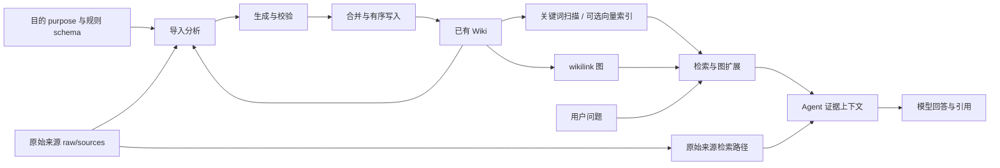

# LLM Wiki 知识架构导学

基于版本 0.6.13 / `e08cfce` 的源码阅读。上游能力与本地工程改进分开记录；已完成 8 来源真实导入、图与问答，实际质量问题见 `experiment/D1-验收记录.md`。实验入口：`experiment/README.md`。

## 1. 前置知识（面试高频）

| 知识点 | 为何需要 | 在本项目中的位置 | 高频度 |
| --- | --- | --- | --- |
| RAG 与上下文预算 | 区分检索、生成、引用和答案正确性 | Rust search、agent | 高 |
| React、Zustand、订阅 | 判断界面为什么没有随队列状态更新 | activity-panel、ingest-queue | 高 |
| Promise、AbortSignal | 解释取消请求与任务真正停止的时间差 | ingest、llm-client | 高 |
| 持久化与派生索引 | 解释 raw、Wiki、向量库的一致性边界 | ingest-cache、embedding | 高 |
| 并发与临界区 | 并行准备如何避免覆盖共享 Wiki | ingest-commit-coordinator、project-mutex | 高 |
| Markdown、frontmatter、图 | 生成知识的可读性、关系和来源追踪 | frontmatter、wiki-graph | 中 |
| Tauri IPC | 浏览器界面如何调用 Rust 文件、检索和 Agent 能力 | commands、src-tauri | 中 |

## 2. 重点亮点与学习顺序（先看这个）

| 亮点标题 | 为什么重要 | 通用技术关键词 | 先看哪些文件 | 建议学习顺序 |
| --- | --- | --- | --- | --- |
| 知识编译与证据分层 | 避免把 Wiki 当成原始事实 | provenance、派生视图 | src/lib/ingest.ts | 1 |
| 可验证的持久化结果 | 模型输出必须经过解析、路径约束与合并 | 文件协议、checkpoint | src/lib/ingest.ts、src/lib/ingest-sanitize.ts | 2 |
| 并发准备与有序提交 | 共享目录和实体页存在并发写风险 | 临界区、取消、队列 | src/lib/ingest-commit-coordinator.ts | 3 |
| 多路检索与排名融合 | 召回能力由实际通道决定 | RRF、图扩展、chunk | src-tauri/src/commands/search.rs | 4 |
| 任务状态的真实表达 | 停止执行不能被当作成功 | 派生状态、订阅通知、恢复 | src/components/layout/activity-panel.tsx | 5 |

## 3. 必备知识点

- [ ] 画出原始来源、生成页、索引和控制文件之间的箭头。
- [ ] 说清分析结果与最终页面不是同一份内容。
- [ ] 能解释缓存失效、索引失效和语义过时的差别。
- [ ] 能举例说明取消不等于回滚、重试不等于全流程幂等。
- [ ] 能区分上游已有能力、本地修改与尚未实测的假设。
- [ ] 用八份来源验证至少一个跨文档答案、一个历史冲突和一个证据不足问题。

## 4. 推荐阅读（结合仓库，约 3 小时）

| 主题 | 通用技术点 | 建议阅读位置 | 预计时间 | 读完能回答什么 |
| --- | --- | --- | --- | --- |
| 导入主链路 | 两阶段、预处理、输出解析 | src/lib/ingest.ts | 45 分钟 | 每次导入何时调用模型、何时写磁盘？ |
| 生成结果与追溯 | 来源标识、前置元数据、页面合并 | src/lib/source-identity.ts、src/lib/page-merge.ts、src/lib/ingest-sanitize.ts | 20 分钟 | 同名来源、共享概念、错误路径怎么处理？ |
| 增量与恢复 | 内容 hash、输出存在性、checkpoint | src/lib/ingest-cache.ts、src/lib/ingest.ts | 20 分钟 | 何时跳过，何时需要重建？ |
| 任务调度 | 可配置并发、有序提交、项目切换 | src/lib/ingest-queue.ts、src/lib/ingest-commit-coordinator.ts、src/lib/project-mutex.ts | 25 分钟 | 分析可并行，写入为何仍需协调？ |
| 查询检索 | 关键词、向量、RRF、一跳图扩展 | src/lib/search.ts、src-tauri/src/commands/search.rs、src/lib/embedding.ts | 30 分钟 | 为什么不能直接相加不同检索分数？ |
| 查询生成 | Agent 路由、工具、证据上下文 | src-tauri/src/agent/router.rs、src-tauri/src/agent/context.rs、src-tauri/src/agent/runtime.rs | 20 分钟 | 查询为何不是只把所有 Wiki 发给模型？ |
| 图与前端改进 | 相关性、社区、派生 UI 状态 | src/lib/graph-relevance.ts、src/lib/wiki-graph.ts、src/components/layout/ingest-queue-status.ts | 20 分钟 | 图上的连接代表什么、任务进度如何定义？ |

## 5. 自学提醒

若某文件或原理看不懂，请继续追问 AI；本技能负责给学习路径与题目，不提供逐行讲解。每读完一段，应使用具体来源或失败场景复述，避免只记功能名。

## 6. 项目技术定位

交叉方向：React/TypeScript 前端 + Rust 桌面服务 + LLM 知识编译与检索。适合前端候选人从异步状态、可观测性和失败恢复切入，再扩展到 AI 应用的数据一致性。

## 7. 核心原理解析

### 7.1 问题：原始文档、知识与索引容易混淆 → 机制：区分证据和派生数据 → 落点：项目目录

raw 保存证据；Wiki 是模型生成、可人工修改的知识视图；LanceDB 是可重建的派生索引。schema 和 purpose 是控制文件，不是查询索引。所谓“原始来源不可变”是保留原件的设计意图，当前应用允许外部编辑并通过 watcher 更新，不能讲成系统强制只读。

### 7.2 问题：边读边写会混合分析与落盘决策 → 机制：两阶段知识编译 → 落点：导入编排

源码先预处理并检查缓存，再构建分析请求；随后把分析、原文与 Wiki 上下文提供给生成阶段。输出中的文件块经过解析、路径约束、日期与来源处理，再合并写入。复杂格式、长文档分块、输出续写、合并与补全可能增加请求次数，**不能保证每份文档恰好两次 LLM 调用**。

这把部分综合工作前移到导入阶段，查询能够复用持续维护的页面。代价是导入延迟、额外 token、生成错误传播、过时知识和更新一致性。是否优于传统 RAG 取决于资料更新频率、问题重复度、生成质量和维护成本，不能只凭架构宣称更准确。

### 7.3 问题：并行任务可能覆盖共享页 → 机制：并行准备、有序提交、项目级互斥 → 落点：队列与提交协调

当前版本默认导入并发为 1，但允许配置更高并发。队列为任务保留提交顺序，准备阶段可以并行；真正的写入再进入项目级临界区。取消、项目切换和失败需要释放保留的位置，避免后续任务永久等待。它不是数据库事务，已完成写入未必能回滚。

### 7.4 问题：单一路径检索容易漏掉表达差异 → 机制：多路排名融合与图扩展 → 落点：Rust search

前端搜索通过 IPC 调用 Rust。后端完成关键词分词和评分，可选向量结果按页聚合；有向量命中时执行 RRF，常数为 60。随后保留约 15%–30% 的窗口给一跳图扩展，实际比例受向量覆盖影响。图通道缺少候选时归还名额。

README 的旧描述包含两跳扩展与固定预算比例；当前不能不加区分地套用到全部 Agent 查询路径。图可视化的四信号相关性与 Rust 检索的一跳扩展也不是同一个算法。接口 mode 为 hybrid 时，还应检查 vectorHits、graphHits；仅有图扩展也可能显示 hybrid，不能据此证明用了向量。

### 7.5 问题：重复导入浪费计算、部分失败可能污染缓存 → 机制：内容 hash 与输出存在性校验 → 落点：增量缓存

缓存记录来源身份、预处理内容的 SHA256 和输出路径；内容未变且所有输出仍存在才命中。成功且没有未修复写入失败/截断时才保存本轮缓存。长文与生成阶段另有 checkpoint，以实际 fingerprint 规则校验。

内容 hash 并不覆盖所有语义依赖，例如模型、purpose、schema 改变后，同一份原始内容仍可能命中旧结果。完整失效策略应纳入依赖版本或显式重建。全流程幂等、跨文件原子性、语义正确性也不能从“有缓存”直接推出。

### 7.6 问题：停止执行被展示为成功、状态变更没有通知 → 机制：按事实派生展示状态 → 落点：本地 D3 改进

成功、失败、取消分别计数和着色，进度条的无障碍成功值仅取成功数。缺少配置与暂停优先展示停止状态，任务错误允许展开查看完整内容。空闲暂停和恢复显式通知订阅者。取消和重试仍复用上游逻辑，没有新增后端调度系统。

## 8. 关键设计决策

| 决策 | 备选 | 取舍 | 风险 | 验证 |
| --- | --- | --- | --- | --- |
| 持久 Wiki + 检索 | 每次直接检索原文 | 可阅读、可维护、复用综合结果；导入成本前移 | 错误或过时综合被复用 | Q2、Q6、Q7；对比原始来源模式 |
| Markdown 文件 | 数据库存储全部知识 | 便于检查、导出、版本比较 | 跨文件写入不是事务 | 失败注入、检查部分结果和重试 |
| 内容 hash 缓存 | 每次重建 | 减少重复模型调用 | 不覆盖全部控制依赖 | 不改原文改 purpose，检查是否仍命中 |
| 结果分色 + 独立成功值 | 继续使用终态总比例 | 语义明确；不提供虚假时间估算 | 整个条填满可能仍被误读 | 文本同时显示三类计数；人工核验 |
| 显式订阅通知 | 定时轮询 | 不增加空闲轮询开销 | 内部状态变化漏通知会导致陈旧 UI | 暂停/恢复回归测试 |
| 保留已有取消语义 | 增加自动删除已写文件 | 避免误删共享页面 | 已写入的部分结果需要重试收敛 | 中途取消后检查共享页及来源引用 |

## 9. 量化与验证（含待测）

已记录：`experiment/evidence/D3-before.txt` 中暂停/恢复通知测试失败；修复后定向 97 项通过；离线 2073 项通过；MCP 25 项通过；前端构建通过。所有数字仅表示本机执行的测试结果，不代表质量或生产收益。

建议后续固定模型、预算和语料提交，记录：每份导入总耗时与阶段耗时、请求/输出 token、缓存命中时是否无新增模型调用、取消信号到停止写入的延迟。查询按 `experiment/questions.json` 检查关键事实覆盖、来源引用支持程度、过时答案和无依据推断。样本数只有 8 时报告逐题结果，不声称统计显著。

已完成：8 份来源全部真实导入，50 个 Markdown；生成知识页来源可解析；图完整结果 41 节点/135 链接，原生默认显示 38/128；8 个固定问题与 Q6 原文模式对照。人工判断为 4 个核心通过、3 个部分通过、1 个协议失败，不作为通用准确率。实测还观察到早期概念页没有自动吸收后续来源的全部澄清，说明来源处理完成不等于全库语义一致。

待测：原文修改后的语义更新、控制文件变化后的失效、向量通道端到端、正在执行任务的取消延迟、生产收益。构建成功与格式/文件检查不能代替这些验收。
